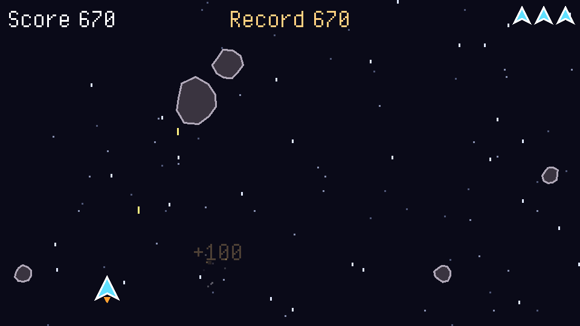

# Astéroïdes: a real-time example

A small shooter made with Heaps from the skeleton of this skill (`../skeleton`): the ship moves
with the keyboard or a gamepad (analog stick) and shoots the asteroids falling from the top; big
ones split into two medium ones, medium ones into two small ones. Three lives; the best score
is saved. The texts of the game are in French (accents included: the default font has them).

| Command | Result |
|---|---|
| `haxe build-js.hxml` | `bin/game.js`: serve the folder (`npx http-server -c-1 .`) and open `index.html` |
| `haxe build-hl.hxml` | `bin/game.hl`: `hl bin/game.hl` from this folder (reads `res/`, reloads changed files) |
| `haxe test.hxml` | tests of the rules (`test/TestField.hx`), without a window |
| `python3 tools/make_sounds.py` | writes the synthesized sound effects of `res/sound/` again |

Controls: arrows, Z Q S D or W A S D (or the left stick, analog, or the D-pad) to move; Space or
X (gamepad A, X, RB, RT), held, to fire; Escape or P (Start or B) to pause, which also happens
when the window loses the focus.

What it shows, beyond the skeleton:

| File | Shows |
|---|---|
| `src/model/Field.hx` | real-time rules without Heaps: `update(dt, moveX, moveY, fire)` returns events; long frames cut into steps of 1/60 s (no bullet through an asteroid); a seeded random generator, the same everywhere |
| `test/TestField.hx` | rules tested frame by frame, including a 1 second frame and the same game from the same seed |
| `src/Controls.hx` | `Fire` held, analog `moveX()` / `moveY()` (keys, D-pad and stick, `axisDeadZone`), `onFocusLost` |
| `src/screen/GameScreen.hx` | the field drawn again every frame with `h2d.Graphics`; nothing updated while paused; pause on focus lost; game over panel that waits 1.2 s before accepting a choice (fire and confirm share Space and A); score saved before the next screen is created |
| `src/view/` | ship and rocks drawn with lines (`Shapes`), scrolling stars (`Starfield`), sparks (`Particles`) |
| `src/Audio.hx` | the music option shown only when a music file exists |

Built and tested with Haxe 4.3.7, Heaps git `a038545` (October 2026) and HashLink git (SDL3).
The web build was played in headless Chromium (keyboard, gamepad, pause, game over, best score
saved and read again); the HashLink build compiles.
