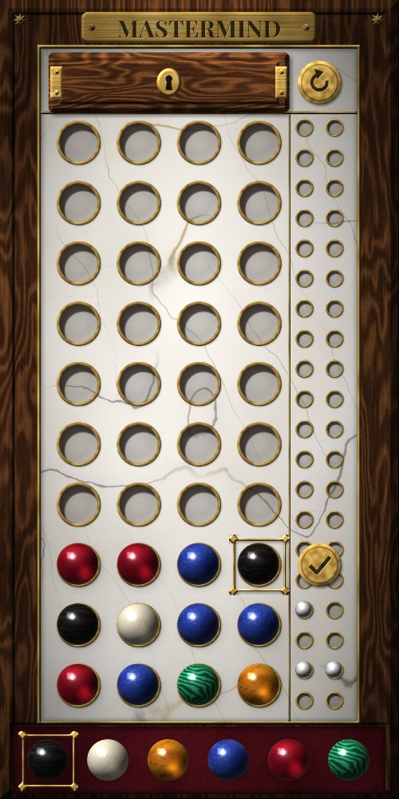

# Mastermind in <a href="https://haxe.org" > HAXE </a>

Simple adaptation du jeu Mastermind avec le moteur de jeu [Heaps.io](https://heaps.io/) utilisé et maintenu par le studio [ShiroGames](https://shirogames.com/).

[Jouer!](https://mastermind-haxe.netlify.app/)

## Compilation

Il faut installer [Haxe](https://haxe.org/download/) puis la bibliothèque Heaps :

```
haxelib install heaps
```

Haxe compile vers d'autres langages ; chaque fichier **.hxml** décrit une cible :

| Commande | Résultat |
|---|---|
| `haxe compile_js.hxml` | version web dans `build/js/` : ouvrir `build/js/index.html` via un serveur local (par exemple `npx http-server build/js`) |
| `haxe compile_dev.hxml` | version HashLink de debug, `build/hl/main.hl`, à lancer avec `hl build/hl/main.hl` (demande aussi `haxelib install hlsdl`) |
| `haxe test.hxml` | tests des règles, exécutés directement par l'interpréteur Haxe (sans fenêtre) |

`compile_base.hxml` contient ce qui est commun aux cibles.

## Organisation du code

```
src/
  Main.hx                    l'application : fenêtre, mise à l'échelle, nouvelle partie
  Game.hx                    une partie : relie les règles à l'affichage
  mastermind/Mastermind.hx   les règles et l'état de la partie (aucune dépendance à Heaps)
  view/BoardView.hx          l'affichage du plateau et les clics
test/TestMastermind.hx       tests des règles
res/Image/                   les images, embarquées par hxd.Res
```

Le détail des choix (et ce qui a changé par rapport à la première version) est dans [REVUE.md](REVUE.md).

## Capture d'écran



